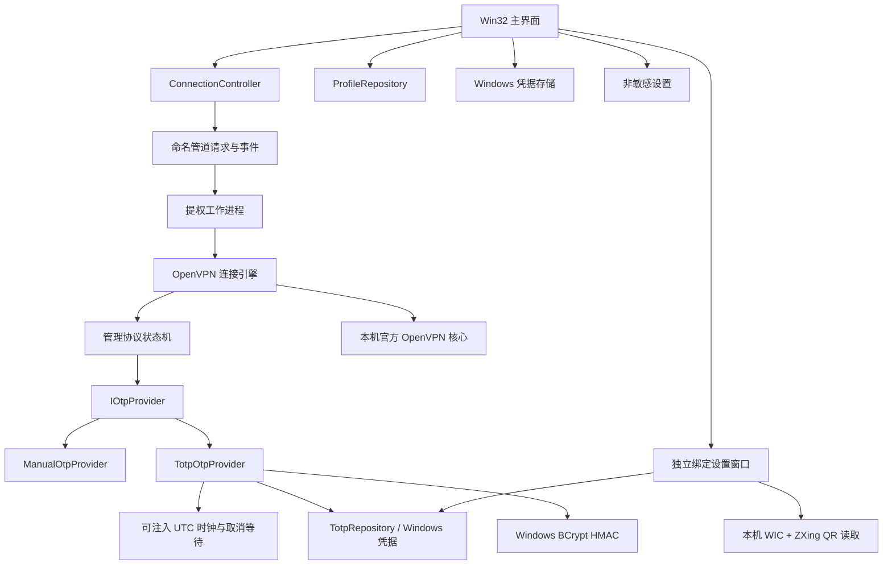

# 模块边界与扩展约定

## 依赖方向

UI 不解析管理协议，不启动命令行脚本，不直接操作路由。协议层不调用窗口、持久化或网络 API。控制器管理 UAC、IPC 和线程生命周期，连接引擎管理单个 OpenVPN 子进程。公司配置和私钥不进入源码目录或发行包。

## 验证码接口

`IOtpProvider::GetCode` 的输入包含配置 ID、用户名、服务器挑战文本和取消令牌。返回值包含 6 位字符串及可选的真实过期时间；协议层再次验证数字、长度和过期时间。

首版 `ManualOtpProvider` 对一个连接尝试只提供一次验证码。公司目前要求密码后拼接验证码；静态挑战标记存在时按管理协议打包。交互式 CRV1 二次挑战暂不支持，认证失败后结束本次尝试，不无声重试同一验证码。

0.2 已实现 `TotpOtpProvider`：在管理接口请求认证时读取受保护密钥，按 UTC 时间计算验证码及真实过期时间。临近过期或上一次已使用同一计数周期时，等待新周期；等待响应取消。上次取用周期也按配置和用户名隔离保存，避免重开连接进程后立即复用验证码。系统时间回退会结束取码。

TOTP 流程按 RFC 6238 实现，SHA/HMAC 使用 Windows CNG，不自行实现密码学哈希。绑定 URI、Base32、TOTP、时钟、凭据仓库、QR 读取和设置窗口分别承担单一职责。`cmake/ZXing.cmake` 固定源版本和校验和，构建时不修改第三方源码；GCC 16 静态链接采用统一 Release 优化，规避上游部分文件 `-Os` 引起的缺失字符串构造函数引用。

绑定密钥不通过 UI/helper 的 IPC 发送；只发送模式，工作进程根据配置和用户名读取 Windows 凭据。手动验证码继续沿受限 IPC 发送，但不再持久化；旧版保存的手动验证码在升级读取配置时清理。“删除绑定”是独立操作，不与清除登录信息混用。

后续增加其他自动获取模块的步骤：

1. 新增实现 `IOtpProvider` 的类，独立实现获取、错误处理和取消。
2. 在 `RunElevatedWorker` 的组装点替换提供器。不要把验证码获取代码写进窗口过程或协议解析器。
3. 遵守取消令牌，为外部请求设置超时；不要在日志中输出获取结果。
4. 用假提供器测试过期、取消、返回格式错误和外部服务失败。现有测试已覆盖上下文传递及过期拒绝。

## 生命周期与并发

- 所有控件只能由 UI 线程操作。连接事件通过 `PostMessage` 入队，接收方取得事件对象所有权。
- 一个 `ConnectionController` 同时只持有一个 helper；断开/退出时先通知 helper 正常停止。
- 取消是独立的、带用户/管理员 ACL 的 Windows 命名事件；`Stop()` 仅设置原子状态和事件，绝不从 UI 线程操作同步管道或等待后台进程。管道只在握手阶段发送请求，之后只接收事件；后台通过事件与父进程句柄观察取消，不在并发同步写期间调用 `PeekNamedPipe`。
- 读取线程监视 helper 退出及停止超时，取消卡住的同步读取。连接进程独立监视停止事件，先发官方退出事件，必要时只回收本次连接的 Job Object。连续点击断开只触发一次取消。
- 普通界面与 helper 通过随机管道名和双向 PID 校验绑定。helper 与官方核心通过随机管理口令及 TCP 端点归属校验绑定。
- 工作进程中的取消监视器独立观察断开请求，为以后的耗时验证码提供器传递取消令牌。
- 子进程只继承所需的标准输入/输出句柄。Windows 命名退出事件用于正常停止，Job Object 只作为异常回收后备。

## 编程规范

- C++20，四空格缩进，遵循根目录 `.clang-format`；不把业务逻辑集中在窗口回调。
- Windows `HANDLE`、socket、线程、进程属性表以 RAII 管理；禁止全局结束所有 OpenVPN 进程。
- Windows 边界用 UTF-16；配置、管理协议和 IPC 使用 UTF-8。命令行、配置与管理协议分别使用对应的转义函数。
- 禁止用账号信息构造 shell 命令。拒绝配置中的脚本、插件、嵌套配置及自定义管理接口。
- 密码可选记住，绑定密钥使用 Windows 凭据管理器；单次验证码只在必要的内存/受限 IPC 中存在，不写入凭据存储、INI、参数和诊断。
- 以编译警告作为错误构建。新增协议及配置能力必须补充边界测试；不以模拟状态代替真实连接成功事件。

## 验证范围

自动检查覆盖登录数据拼接与转义、前导零、验证码单次使用与过期、配置迁移、依赖文件、分流参数、危险参数拒绝、记忆字段独立删除和 IPC。

`--probe` 启动真实官方核心，完成管理认证，在 HOLD 状态通过官方退出事件正常结束；不会释放 HOLD 或发起公司连接。当前没有真实账号及真实绑定密钥的端到端验证。首次实连后需验证手机验证码一致性、认证、内网服务、公司 DNS、路由分流和断开恢复，特别是公司服务器的证书用途与加密算法兼容性。

TOTP 独立测试覆盖 RFC 附录 B 全部 18 组向量、URI 参数和无效输入、前导零、过期、时钟回退、取消、跨连接计数记录、账号隔离，以及正常/旋转/多码/非绑定/空白图片。

0.2.1 增加真实子进程和 Windows 命名管道的断开回归测试，模拟认证后不再读请求、半条消息、延迟退出、IPC 建立前取消和异常退出，检查 UI 侧 `Stop()` 立即返回且只发一个最终停止事件。测试不提交公司凭据或配置 VPN 网卡。

`TotpPreview` 只缓存显示用验证码，按配置、用户名和时间周期失效，不调用使用计数仓库。主窗口定时器只更新实际变化的文本与倒计时区域，标题和按钮仅在状态变化时更新。父窗口使用 `WS_CLIPCHILDREN` 和双缓冲，诊断编辑框延迟到首次展开时创建。

0.2.2 将边界检查间隔缩短到 100ms，计数周期或倒计时整数未改变时不触发绘制。`TotpParameterDetector` 使用已有密钥和两轮手机码缩小候选参数；仅保留候选算法、周期及时间计数，不保留输入验证码。同一手机计数窗口的重复输入不作为第二轮，确认后只填充参数，必须显式保存。此功能不能恢复未知密钥，也不对公司服务器发起验证请求。

已绑定后仅修改算法/周期时，设置窗口复用现有密钥并实际保存参数。保存相同参数不清空防复用计数，参数改变才重置对应记录。Windows 密码输入的“显示密码”仅改变遮罩，默认隐藏且不保存该开关。
